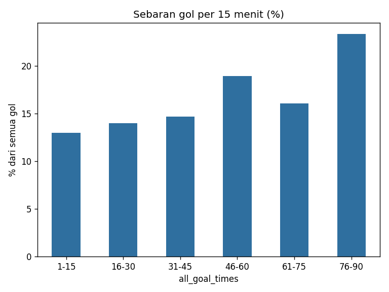
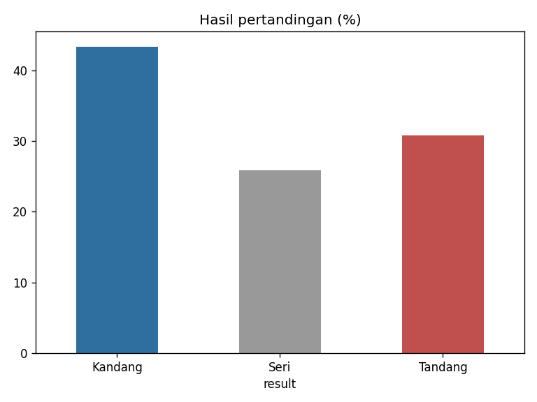
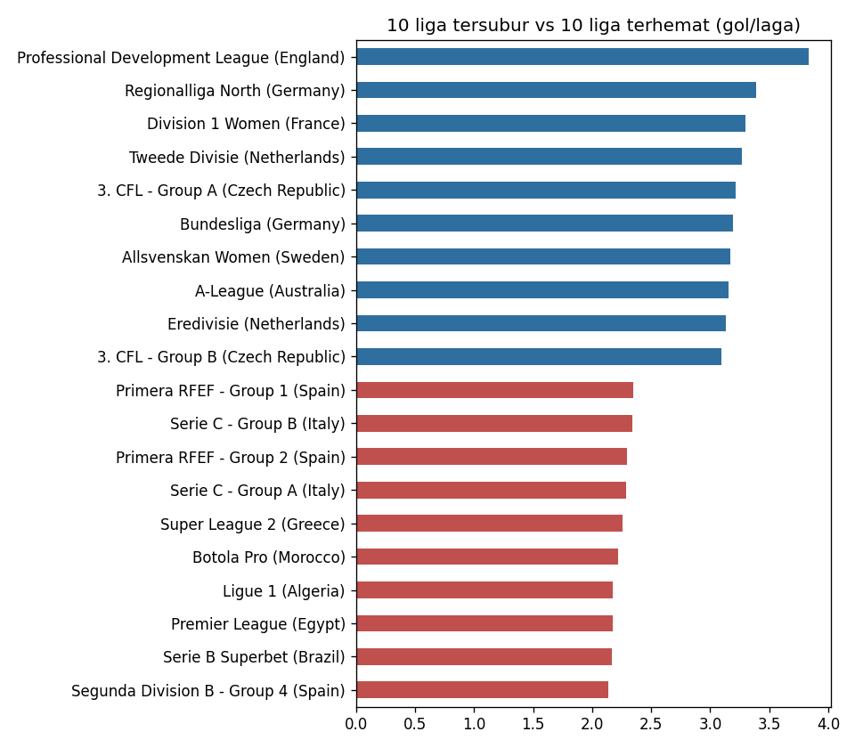

# Analisis Waktu Gol & Hasil Pertandingan Sepak Bola (91 Liga, 2022–2026)

Analisis eksploratif dengan Python (pandas, matplotlib) terhadap **76.928 pertandingan** dari 91 liga di 41 negara: kapan gol paling sering terjadi, seberapa besar keunggulan kandang, liga mana yang paling subur, dan seberapa sering tim yang unggul di babak pertama akhirnya menang.

## Temuan utama

| Pertanyaan | Hasil |
|---|---|
| Kapan gol paling sering terjadi? | Menit **76–90** (23,4% dari 208.198 gol); menit 1–15 paling sedikit (13,0%) |
| Babak mana yang lebih produktif? | Babak kedua: **58,3%** gol vs 41,7% di babak pertama |
| Seberapa besar keunggulan kandang? | Menang kandang **43,3%**, seri 25,9%, menang tandang 30,8% |
| Rata-rata gol per laga | **2,71**; tertinggi Professional Development League (Inggris) 3,83, terendah Segunda División B Grup 4 (Spanyol) 2,14 |
| Unggul saat turun minum → menang? | **73,8%** dari 45.167 laga |
| Gol pertama | Median di menit **26**; hanya 7,5% laga berakhir 0-0 |

## Cara menjalankan

1. Unduh `football_charts_matches.csv` dari [Zenodo](https://zenodo.org/records/22295584) ke folder `data/`.
2. `pip install -r requirements.txt`
3. `python analyze.py` → ringkasan tercetak dan tersimpan di `hasil.txt`, grafik di `charts/`.

## Catatan metode

- Gol dikelompokkan per 15 menit; gol injury time tercatat di menit 45/90 sehingga masuk kelompok 31–45 dan 76–90.
- 7 entri waktu gol bertuliskan "Not found" dibuang.
- Perbandingan antarliga hanya untuk liga dengan minimal 300 laga.

## Sumber data

*Football Match Results and Goal Timing, 91 Leagues (2022–2026)* oleh Damir Devetak / [football-charts.com](https://www.football-charts.com), [Zenodo](https://zenodo.org/records/22295584), lisensi CC BY 4.0.
